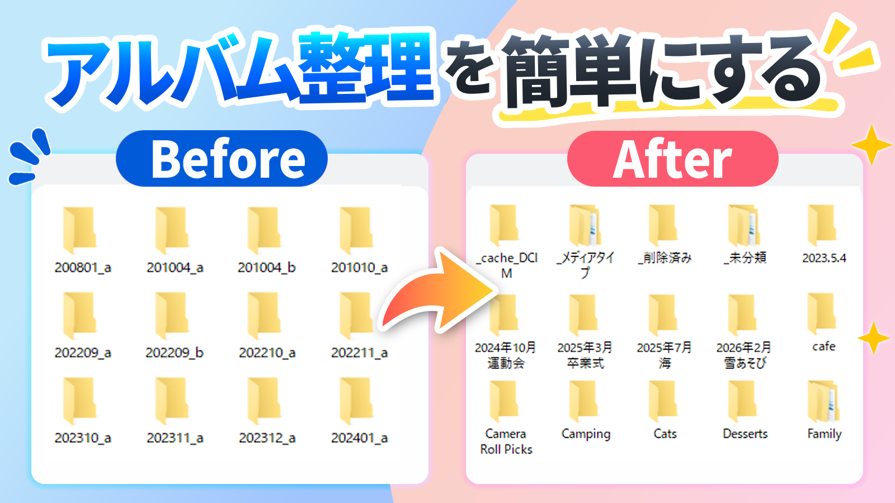

# XYZETON アルバムバックアップ（Windows用）

iPhoneの写真を、アルバム構造のままWindowsへ保存するツールです。



左は、エクスプローラーでiPhoneを開いた画面です。写真は撮影年月のフォルダにしか分かれていません。
右は、このツールで書き出した結果です。iPhoneのアルバムがそのままフォルダになります。
どのアルバムにも入っていない写真は `_未分類`、ビデオやスクリーンショットは `_メディアタイプ` に入ります。

iPhoneの写真アプリで作った「フォルダ」「アルバム」の分け方を、**そのまま**パソコンのフォルダとして保存します。

- Windowsの「フォト」でよく起きるフリーズや「**デバイスに到達できません**」が起きません（同じ仕組みを使っていないため）
- エクスプローラーで見ると写真が「202608_a」のような日付フォルダにまとめられていて、どこに何があるか分からない問題を解決します
- ファイル名の先頭に撮影日時が付くので、名前順に並べると撮影順になります
- 途中で止まっても、もう一度実行すれば続きから再開します

```
完成イメージ
E:\iPhoneAlbums\
 ├─ 家族\
 │   └─ 運動会\      20240105_120000_IMG_0003.HEIC, 20240105_120000_IMG_0003.MOV ...
 ├─ 旅行2025\        20240106_103000_IMG_0001.HEIC ...
 ├─ _メディアタイプ\  iPhoneの「メディアタイプ」と同じ分類（ビデオ／セルフィー／Live Photos／…）を 年\年-月 で
 │                    ※アルバムに入れていない子どもの動画なども、ここの「ビデオ」から探せます
 ├─ _未分類\         どのアルバムにも入れていない写真（年\年-月 で整理）
 ├─ _削除済み\       （任意）iPhoneで消した/外した写真の退避先
 ├─ _album_state.json  アルバム名変更の追従に使う記録（消さないでください）
 └─ _cache_DCIM\     写真の実体（消さないでください ※よくある質問参照）
```

> **動作確認済み**: iPhone 11 Pro Max / iOS 26.6.1 / Windows 10・Windows 11 /
> Apple純正USBケーブル / 写真・動画 84,000点（207GB）
> これ以外の環境は未確認です。iOSのアップデートで動かなくなる可能性があります（無保証・自己責任）。

---

## ■ 使い方（exe版・おすすめ）

### 用意するもの
- Windows 10/11 のパソコン
- **空き容量**: 下の「必要な容量」を必ず確認してください
- **Apple純正のUSBケーブル**（動作確認は純正のみで行っています）
  > ⚠ 非純正ケーブルは**動作保証の対象外**です。すべてのケーブルを検証できないためです。
  > 実際に、エクスプローラーではiPhoneの中身が見えるのに、本ツールでは接続できない例がありました。
  > エクスプローラーと本ツールは通信の仕組みが違うため、エクスプローラーで見えていても接続できるとは限りません。
  > うまくいかない場合は、まず純正ケーブルでお試しください。充電専用ケーブルは使えません。

### 必要な容量

**保存先とキャッシュが同じドライブ（NTFS）にある場合**
必要なのは **iPhoneの写真・動画の合計＋少し** です。
アルバムや種類別フォルダの中身は実体のコピーではなく「ハードリンク」（同じファイルを指す別名）です。
そのため、同じ写真がいくつのフォルダに現れても、ディスクの使用量は増えません。
> 実測例: 写真の実体167GB / ファイル数255,205 → ディスクの実消費は約167GB

> ⚠ **エクスプローラーのフォルダサイズは、実際よりずっと大きく表示されます。**
> エクスプローラーはハードリンクを1件ずつ数えます。1枚の写真が「キャッシュ・アルバム・種類別フォルダ」の3か所に現れると、3回分が加算されます。
> 実測例: 実体167GBのバックアップが、フォルダのプロパティでは540GBと表示されました（3.2倍）。
> 表示どおりにディスクの空き容量が減っているわけではありません。実際の使用量は、ドライブのプロパティの「使用領域」で確認してください。
>
> ハードリンクになっているか確かめるには、PowerShellで次のコマンドを実行します。同じ実体を指すパスが一覧表示され、複数表示されれば正常です。
> ```
> fsutil hardlink list "E:\\iPhoneAlbums\\<アルバム名>\\<ファイル名>"
> ```

**保存先がNTFS以外（exFAT / FAT32 の外付けドライブなど）、または保存先とキャッシュが別ドライブの場合**
ハードリンクが使えないため、同じ写真がフォルダの数だけ実体としてコピーされます。
この場合は、実際に **写真の合計の3倍前後**（207GBなら600GB以上）の空き容量が必要です。
アプリは開始時にハードリンクが使えるかを検査し、使えない場合は
`⚠ この保存先ではハードリンクが使えません` と表示します。
この警告が出たら、**保存先を NTFS のドライブに変える**のが最善です。

外付けドライブを使う場合は、フォーマットが NTFS かどうかを確認してください
（ドライブを右クリック → プロパティ → 「ファイルシステム」）。exFAT ではハードリンクが使えません。

### 1. Apple の接続ソフトを入れる（最初の1回だけ）
このツールは iTunes と同じ仕組みでiPhoneと通信します。この通信には
**Apple Mobile Device Service** というWindowsのサービスが必要なため、次のどちらかを入れてください。

- **Windows 11**: Microsoft Store の「**Appleデバイス**」アプリ（推奨）
- **Windows 10**: Apple公式サイトの **iTunes**

入れたら一度起動して、iPhoneが認識されることを確認してください。確認できたら閉じて構いません。

> ⚠ **iTunes と「Appleデバイス」を両方入れると競合することがあります。** どちらか片方にしてください。
> 入れ替えた場合は、PCを再起動してから使ってください。

### 2. ダウンロードして展開（インストール作業はありません）
このソフトはインストール不要です。zipを展開して、中のexeを実行するだけです。

1. ダウンロードした zip を右クリック →「すべて展開」を選びます。
   > ⚠ **zipを開いた中のexeを直接ダブルクリックしないでください。**
   > exeが一時フォルダで動くため、次回起動時にアルバム情報（数GB）を取り直すことになります。必ず先に展開してください。
2. 展開してできた `XYZETONAlbumBackup` フォルダを、置いておきたい場所へ移動します。

**置き場所の選び方**
- おすすめは、`D:\XYZETONAlbumBackup` や `C:\Users\<自分の名前>\XYZETONAlbumBackup` など、自分で自由に書き込める場所です
- このフォルダの中に、iPhoneのアルバム情報（数GB。iPhone 11 Pro Max・8万枚で約7GB）が保存されます。**その分の空き容量があるドライブ**に置いてください
- 「ダウンロード」フォルダのままでも動きます。ただし、後でダウンロードフォルダを整理したときに一緒に消え、次回また数GBの取得が必要になります
- `C:\Program Files` に置いても動きます（書き込めない場合は、保存先を自動でユーザー領域に切り替えます）。ただし、おすすめしません
- フォルダごと別のドライブへ移動しても、そのまま使えます

3. フォルダの中の `XYZETONAlbumBackup.exe` をダブルクリックします（よく使う場合は、デスクトップにショートカットを作ると便利です）。

> **「WindowsによってPCが保護されました」と出たら**
> 個人開発のソフトに必ず出る警告です（有料の証明書を買わない限り表示されます）。
> 青い画面の「**詳細情報**」をクリックし、「**実行**」を押してください。

> **「スマート アプリ コントロールがブロックしました」と出たら**
> 上の警告とは別の機能です。まず OK を押して、もう一度起動してみてください。
> それでも起動できない場合の対処は2つあります。詳しくは下のよくある質問をご覧ください。
> 最も手軽なのは、exeを使わず `source` フォルダから直接動かす方法です。

### 3. iPhone をつなぐ
USBでつなぐ → iPhoneのロックを解除 → 「このコンピュータを信頼しますか？」で「**信頼**」をタップ、の順に操作します。
**作業中はiPhoneをロックせず、つないだままにしてください。**

### 3.5 言語（Language）
右上の **日本語 / English** で切り替えられます（次回起動時も記憶されます）。
※ 言語を切り替えると、`_未分類`→`_Unsorted`、`_メディアタイプ\ビデオ`→`_MediaTypes\Videos` のように特殊フォルダの名前も切り替わります。既存のバックアップのフォルダは、次回実行時に自動でリネームされます（写真は増えません）。
英語の説明書は `README_en.md` です。

### 4. 画面の 1 → 2 → 3 を順番に押す
画面は次の要素で構成されています。
- **iPhone カード**: 接続すると、端末名・iOS・写真の件数・容量が表示されます
- **1 / 2 / 3**: 次に押すボタンが濃い色で表示されます。済んだボタンも押せるので、再実行できます
- **進捗**: 実行中は「◯◯/◯◯ 件・◯◯/◯◯ GB・◯%・経過・残り」を表示します
- **バックアップ設定**: ふだんは畳んであります。既定のままで問題ありません。
  変更した内容は次回起動時も保たれます。ただし「写真のダウンロードは飛ばし…」だけは毎回オフに戻ります。
  オンのままだと、写真を取得していないのにバックアップが済んだと思い込んでしまうためです
- **詳細ログ**: ふだんは畳んであります。エラーや警告が出ると自動で開きます

確認のウィンドウ（「開始しますか？」など）は、必ずアプリの中央に表示されます。
モニタが複数あっても、別の画面に表示されることはありません。

画面が縦に長くなった場合は、マウスホイールで画面全体をスクロールできます
（設定とログを両方開いても、下まで表示できます）。

1. **1 接続を確認** … 1分。「✅ 接続できました」「✅ アルバム情報を読めます」と表示されれば完了です
2. **2 アルバムを確認** … 初回はアルバム情報（数GB）を取得するため10〜20分かかります。自分のアルバムが一覧に表示されれば完了です
3. **保存先** を「フォルダを選ぶ」で選び、**3 バックアップを始める** を押します
   - 数時間かかります。**PCがスリープしない設定**にしてください（設定 → システム → 電源とスリープ → スリープ「なし」）
   - 終わると音が鳴り、保存先フォルダが自動で開きます

### 途中でやめたい／電話がかかってきた
実行中は「3」のボタンが「**■ 中止**」に変わります。押すと取得中のファイルの区切りで止まり、取得済みのファイルはそのまま残ります。
再開するには、3 をもう一度押します。ダウンロード済みの写真は飛ばして、続きから再開します。

### ケーブルが抜けた／接続が切れた
ダウンロード中に接続が切れると「接続が切れました」のウィンドウが表示され、**最大10分待ちます**。
その間につなぎ直すと自動で再接続し、同じファイルの続きから再開します（ウィンドウは自動で閉じます）。
10分を過ぎた場合や、PCが停止した場合も、3 をもう一度押せば続きから再開できます。
アルバム情報（数GBの1ファイル）の取得中に中止・切断した場合も、次回はその続きから取得します。

ログに「📱 iPhoneとの通信は終わりました」と表示された後は、ケーブルを外して構いません。残りの処理はPC内で行います。

---

## よくある質問

**Q. 同じ写真がアルバムと `_メディアタイプ` の両方に入っている。容量は2倍？**
A. 2倍にはなりません。どちらも同じ実体を指す「ハードリンク」です。iPhoneの表示（同じ写真がアルバムにもメディアタイプにも出る）と同じ構造です。
   1つの写真は、メディアタイプの種類のうち **1つだけ** に入ります（例: Live Photoのセルフィーは「Live Photos」）。

**Q. メディアタイプの件数がiPhoneと合わない**
A. 種類の判定に使っている内部コードが、iOSのバージョンによって異なる可能性があります。保存先の `_メディアタイプ診断.txt` を共有してください。

**Q. アプリのフォルダに `_photos_db` ができて数GBある。消していい？**
A. iPhoneのアルバム情報です。消しても動きますが、次回また取得に10〜20分かかります。容量に余裕があれば、残しておくことをおすすめします。

**Q. `_cache_DCIM` フォルダは消していい？**
A. **消さないでください。** アルバムのフォルダ内の写真は、この実体を指す「ハードリンク」です。容量は2倍になっていません。
   どうしても消す場合は、先にアルバムフォルダを別の場所へコピーしてから消してください。

**Q. ファイル名の先頭の数字は？**
A. `20240105_120000_` は、2024年1月5日 12:00:00 という撮影日時です。iPhoneの連番（IMG_9999の次がIMG_0001）のままでは、名前順が撮影順にならないため付けています。
   不要な場合は、画面のチェックを外してください。

**Q. 「iCloudにしか無い写真: ○個」と出た／`_iCloudにしか無い写真.txt` ができた**
A. iPhoneの「iPhoneのストレージを最適化」がオンになっていて、写真のオリジナルがiCloudにしかない状態です。
   ツールはこの状態の写真を先に検出し、どの写真がどのアルバムのものかを一覧に書き出します（取得できた分は通常どおりバックアップされます）。
   iPhoneの 設定 → 写真 で「**オリジナルをダウンロード**」に変えて、Wi-Fiにつないだまま一晩置きます。
   その後、「写真のダウンロードは飛ばし…」のチェックを外して、3 をもう一度押してください。

**Q. `💾 保存先が見えなくなりました` と出て待機する**
A. 転送中に、保存先のドライブ（特に外付けHDD）の接続が切れています。接続を確認してください。
   ドライブが再び認識されれば、自動で続きから再開します（最大30分待ちます）。
   **予防策**: Windowsの電源プランで「ハードディスクの電源を切る」を「なし」にしてください
   （設定 → システム → 電源 → 電源モードの詳細設定 → ハードディスク）。
   USB接続のドライブの場合は、デバイスマネージャーで USB Root Hub のプロパティ →
   電源の管理 →「電力の節約のために…電源をオフにできるようにする」のチェックも外してください。

**Q. `[Errno 13] 保存先に書き込めません` で止まる**
A. ほとんどの場合、ウイルス対策ソフトが書き込み中のファイルを使用中にしていることが原因です
   （空き容量は関係ありません）。一時的なものは自動で待って再試行しますが、
   頻発する場合は、保存先フォルダを Windows セキュリティの「除外」に追加してください。
   設定 → プライバシーとセキュリティ → Windowsセキュリティ → ウイルスと脅威の防止 →
   設定の管理 → 除外の追加または削除。
   保存先ドライブの「内容にインデックスを付ける」をオフにすることも効果があります。
   取得済みのファイルは残っているので、対処後にもう一度実行すれば続きから再開します。

**Q. `_取得失敗一覧.txt` ができた**
A. USBの一時的な不調などで取得できなかったファイルの一覧です。もう一度 3 を実行すると、そのファイルだけを再試行します。
   取得に失敗しても全体の処理は止まらず、取得できたファイルは保存済みです。

**Q. 「スマート アプリ コントロールが安全でない可能性のあるアプリをブロックしました」と出る**

Windows 11 をクリーンインストールした環境などで有効になっている機能です。
アプリを起動するたびにMicrosoftのクラウドで安全性を判断し、判断がつかないアプリのうち
発行元の署名が無いものをブロックします。本ツールは署名を取得していないため、
**初回の起動でブロックされることがあります。**

**まず、OK を押してもう一度起動してみてください。**
作者の環境（この機能がオン）では、1回目はブロックされ、2回目は普通に起動しました。
クラウド側の判断が済んだためと考えられますが、**必ず起動できるとは限りません。**

この機能は「WindowsによってPCが保護されました」の警告とは別物で、「詳細情報 → 実行」はありません。
個別のアプリだけを許可する設定もありません。
もう一度起動してもブロックされる場合の対処は2つです。

**1. exeを使わず、ソースから動かす（おすすめ）**

zipの中の `source` フォルダに、ソースコード一式が入っています。
Python 3.12 があれば、そのフォルダで次のコマンドを実行すると、exe版と同じものが動きます。

```
py -3.12 -m pip install pymobiledevice3==11.3.1 customtkinter==6.0.0
py -3.12 gui.py
```

exeを経由しないので、ブロックされません。

**2. スマート アプリ コントロールをオフにする**

設定 → プライバシーとセキュリティ → Windows セキュリティ →
アプリとブラウザーの制御 → スマート アプリ コントロールの設定 → オフ

最近の Windows なら後からオンに戻せますが、環境によっては戻せないことがあります。
セキュリティ機能を切る操作なので、判断はご自身でお願いします。

**Q. タイトルバーに「(応答なし)」と出る／画面が固まったように見える**

写真の一覧を調べている間など、iPhoneへの問い合わせが集中する場面で表示されます。
**処理は止まっていません。** 画面の更新が止まるだけで、処理は裏で進んでいます。

写真が多いと、この状態が長く続きます。
8万枚・167GB の環境では、表示が最長で約9分固まったままになりました。
次の工程に移ると、表示も元に戻ります。

強制終了せず、そのままお待ちください。
万一終了してしまっても、取得済みのファイルは残り、次回は続きから再開します。

**Q. 非純正のケーブルでも使えますか**
A. 動くものもありますが、**動作保証の対象外**です（すべてのケーブルを検証できないため）。
   実際に、エクスプローラーではiPhoneの中身が見えるのに本ツールでは接続できず、
   純正ケーブルに替えたら接続できたという例がありました。
   接続できない場合は、まず純正ケーブルでお試しください。

**Q. エクスプローラーではiPhoneの中身が見えるのに「接続できませんでした」と出る**
A. エクスプローラーが使う仕組み（MTP）と、このツールが使う仕組み（iTunesと同じもの）は別物です。
   そのため、エクスプローラーで見えていても、このツールで接続できるとは限りません。
   ツールは原因を切り分けて、エラーメッセージに確認する手順を表示します。表示に合わせて次を確認してください。

   **「原因: Windows側の『Apple Mobile Device Service』が動いていません。」と表示された場合**
   1. Windowsキー+R →『services.msc』→ **Apple Mobile Device Service** を右クリック →「開始」
      （スタートアップの種類は「自動」に）
   2. 一覧に無ければ、Microsoft Storeの「**Appleデバイス**」アプリを入れて一度起動する
   3. iTunes と「Appleデバイス」を両方入れていると競合します。片方にして**PCを再起動**する

   **上記以外の場合**
   1. iPhoneのロックを解除し、「このコンピュータを信頼」をタップしたか確認する
      （一度も表示されていない場合は、ケーブルを挿し直す）
   2. **Apple純正のUSBケーブル**に替えて試す
      （エクスプローラーで見えるのに接続できず、純正ケーブルに替えたら接続できた例があります。上の「非純正のケーブルでも使えますか」も参照してください）
   3. 別のUSBポートに挿し替える（USBハブ経由だと不安定なことがあります）

**Q. 写真が .HEIC で開けない**
A. .HEIC はiPhone標準の形式です。Microsoft Store で「HEIF 画像拡張機能」を入れると開けます。

**Q. 2回目以降は？（iPhoneで写真を追加・アルバム名を変更した後）**
A. 「アルバム情報を取り直す」にチェックを入れて、3 を押してください。動作は次のとおりです。
   - 追加した写真 → 新しい分だけダウンロードして追加
   - アルバム名の変更・フォルダ間の移動 → PC側のフォルダも同じ名前・場所に追従（重複フォルダは作りません）
   - iPhoneで消した写真・アルバムから外した写真 → **既定では何もしません**（バックアップは消さない方針です）。
     PC側も揃えたい場合は「…『_削除済み』へ移す」にチェックを入れてください。削除ではなく移動なので、後から戻せます。
   ※ 追従には保存先の `_album_state.json` を使います。消さないでください。

**Q. 「アルバム情報にUSB経由で届きません」と出た**
A. そのiOSバージョンには未対応です。GitHubのIssueに「iOSバージョン・Windowsバージョン・画面のログ」を貼ってください。

---

## ■ 上級者向け（Python版）
exeを使わずにソースを直接動かす場合は、次のコマンドを使います。
```
py -3.12 -m pip install pymobiledevice3 customtkinter
py -3.12 probe.py                              # 接続チェック
py -3.12 album_export.py --list                # アルバム一覧
py -3.12 album_export.py --out E:\iPhoneAlbums # 本番
py -3.12 gui.py                                # GUI版
```
※ Python 3.13以降には依存ライブラリのWindows用バイナリが無いため、**3.12** を使ってください。
オプション一覧は `py -3.12 album_export.py --help` で確認できます。

## お問い合わせ時の注意

「ログをコピー」で得られる内容には、端末名・アルバム名・ファイル名・保存先パスなど、
**個人情報が含まれることがあります**。Issue等で共有する際は、公開しても問題ない内容かを
事前にご確認ください。

## 対応範囲・確認方法

- **対応範囲と既知の制限**: `docs/compatibility.md`
  （確認済み／対象外／**未確認**を分けて記載しています。共有アルバムや編集後の写真は未確認です）
- **取得結果の確認方法**: `docs/verification.md`
  （写真が欠落していないことを確認する手順です。バックアップでは、最後まで実行できたことよりも、欠落がないことの確認が重要です）

> ⚠ ハードリンクは独立したコピーではありません。同じファイルの実体を共有するため、
> ある経路から内容を変更すると、他の経路にも反映されます。
> また、**保存先のドライブが壊れると、すべて失われます**。重要な写真は別の場所にもコピーを持ってください。

## 誰が作ったか

| 担当 | 内容 |
|---|---|
| XYZETON（作者） | 企画、画面設計、実機での検証、不具合の発見、追加要望、公開の準備 |
| Anthropic Claude | プログラムの実装すべて（DB解析、通信、例外処理、テスト、ビルド） |
| OpenAI ChatGPT（GPT-5.6 Sol） | デバッグ、セキュリティチェック |

作者はグラフィックデザイナーで、プログラミングは専門ではありません。

そのため、**使い方・動作・不具合の報告には対応できます**が、
**コードの詳細な設計意図についてはお答えできない場合があります**。
不具合のご報告は、iOSのバージョン・Windowsのバージョン・使用ケーブル（純正か否か）と、
アプリの「ログをコピー」で取得したログを添えていただけると調査しやすくなります。

## 開発支援について

本体は無料です。任意の開発支援の窓口を用意していますが、
**支援によって内容が変わることはありません**（個別対応・動作保証・特別なビルドは付きません）。
窓口の場所は変わる可能性があるため、最新の案内はこのREADMEに記載します。

［支援窓口URL］

## 同梱しているソースコード

GPL-3.0 のため、ソースコード一式を zip の `source` フォルダに同梱しています。

```
source\
├ album_export.py  gui.py  probe.py  conftest.py  build.bat
└ tests\           （リグレッションテスト）
```

exeが使えない環境では、ここから直接実行できます（上のよくある質問を参照してください）。

## 通信について

このツール自身のコードが接続するのは、PC内のAppleのサービス（`127.0.0.1:27015`、Apple Mobile Device Service）だけです。
写真・アルバム名・ログをインターネットへ送る処理はありません。
ネットを切った状態（機内モード）でも、接続からバックアップ完了まで最後まで動作することを確認済みです（2026-09-29・v3.3.1）。

## 作者・ライセンス
作者: **XYZETON**（X: @xyzeton ← 公開時に実アカウントへ）
GPL-3.0-or-later（LICENSE 参照）。利用ライブラリの表記は THIRD_PARTY_NOTICES.md にあります。
企画・画面設計・実機検証は作者が、プログラムの実装は Anthropic Claude が、デバッグとセキュリティチェックは OpenAI ChatGPT（GPT-5.6 Sol）が担当しました（「誰が作ったか」参照）。

本ツールは Apple Inc. とは無関係の個人開発ソフトウェアです。iPhone は Apple Inc. の商標です。

## 仕組み（興味のある人向け）
iPhoneのアルバムは「フォルダ」ではなく、写真アプリ内部のデータベース（Photos.sqlite）の分類タグです。
本ツールはこのデータベースをUSB（AFC）経由で取得し、「アルバム → 写真」の対応表と撮影日時を読み取ります。
写真の実体（DCIM）をダウンロードした後、対応表どおりにハードリンクで振り分けます。
Windowsフォトが使うMTPではなく、iTunesと同じ通信層を使うため、フリーズしません。
